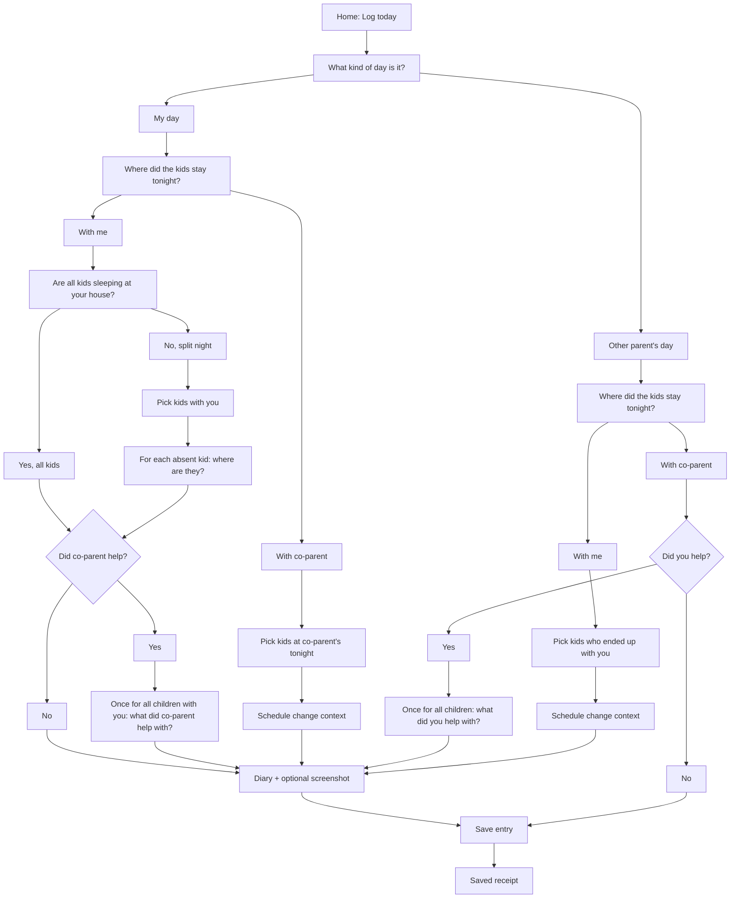
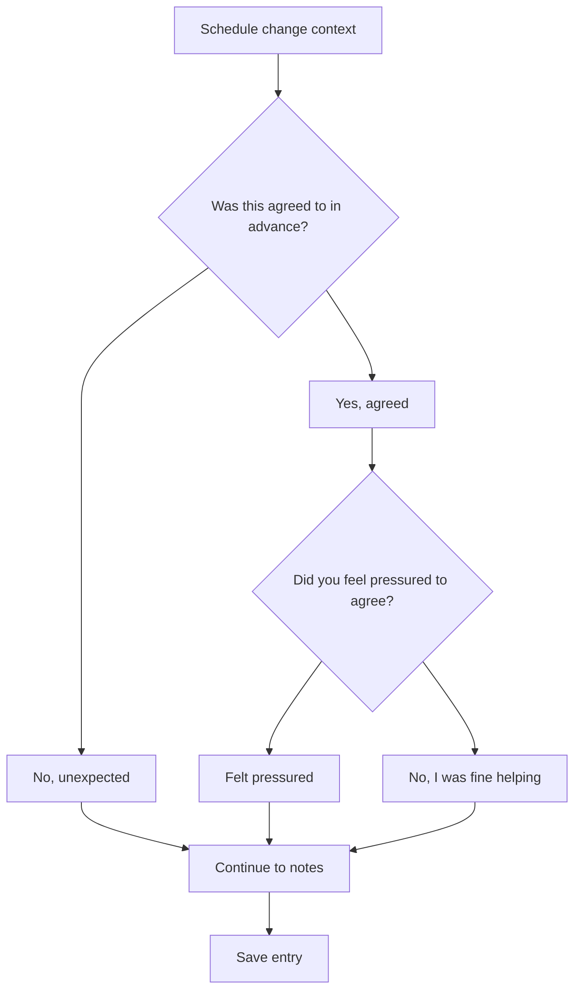

# Whose Day Decision Tree

This document describes the current check-in flow as implemented in `index.html` and `app.js`.

Reviewed October 22, 2026. “Save entry” below is the save action, not a separate
pre-save Review screen. The app shows a receipt after saving; notes and screenshot
prompts appear before save on the applicable branches.

## Main Flow

## Schedule Change Context

This screen appears when custody differs from the scheduled day:

- My day -> kids ended up with co-parent
- Other parent's day -> kids ended up with me

## Stored Entry Fields

Core shape:

- `week`: `dad`, `mom`, or `not-logged`
- `dadMode`: `normal`, `dad-helped-mom`, or `mom-had`
- `momMode`: `easy`, `helped`, or `dad-had`
- `kidsWithDad`
- `absentData`
- `momOpts`
- `helpedKids`
- `helpedData`
- `dadHadKids`
- `momHadKidsOnDadWeek`
- `momHelpedOnDadWeek`
- `diary`
- `attachment`
- `changeAgreed`
- `changePressured`
- `loggedAt`

## Product Decisions

- Users can backfill only yesterday.
- Older empty calendar days show "Nothing logged" and remain read-only.
- Help is captured only after actual overnight location is selected.
- On your scheduled day, co-parent help uses the kids already confirmed as staying with you instead of asking a second kid-selection question.
- On the co-parent's scheduled day, your help uses the kids already staying with the co-parent instead of asking a second kid-selection question.
- Both help branches ask for activities and an optional note once for all applicable
  children, then continue directly to the diary. There is no per-child help loop.
  Shared answers retain the existing record format for sync and backups; identical
  details display together in calendars and reports. Older child-specific answers
  remain intact when reopened and continued without changes.
- Schedule-change context is captured only for true custody deviations, not ordinary help.
- Legacy stored values such as `dad-helped-mom` and `momMode: helped` are still supported, but users now reach them through nested help questions.
- Changing the scheduled parent or actual-custody branch clears answers from the
  abandoned branch while retaining authored notes and screenshots. Reselecting
  an unchanged branch preserves loaded edit details. Returning from split night
  to all kids home clears obsolete absent-child details.

## Odd Paths To Review

- Some internal state names still use Dad/Mom terminology. User-facing copy now mostly renders from the configured parent labels, but internal naming could be clarified later during a larger refactor.
- Visible progress already uses Schedule / Kids / Details phases. Numeric totals
  remain in internal calls but do not drive the visible phase indicator.
- Help on a co-parent day currently applies to all configured children. Optional
  subset selection could improve accuracy, but changes the established flow and
  should be a deliberate product decision.
- The co-parent-day “no help” branch saves directly from its detail screen;
  other paths save from notes. A universal pre-save review would add a step and
  is proposed scope, not an existing screen or an automatic cleanup.

## Good Low-Oversight Cleanup Work

- [x] Browser smoke coverage for configured labels, saved/calendar/report output,
  both schedule-change directions, brief visits, and long names already exists.
- [x] Fixed stale branch answers when changing schedule/custody, with local state
  regressions and actual browser edit/save coverage in both directions.
- [x] The automated release command covers the existing flows and the new branch
  and date-filter regressions; owner-assisted/live checks remain separate.
- [ ] Consider helper extraction during a dedicated maintainability pass; a broad
  rename/refactor is unnecessary for the current behavior fixes.
